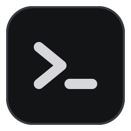
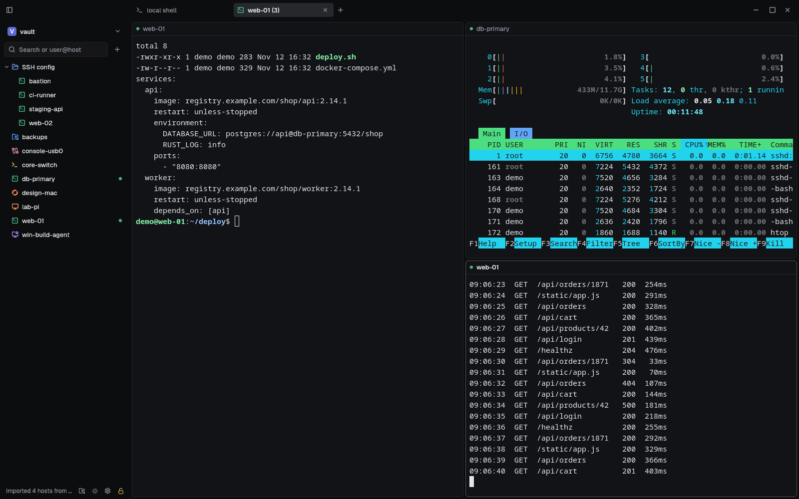
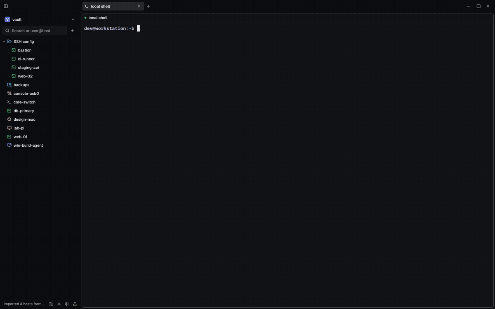
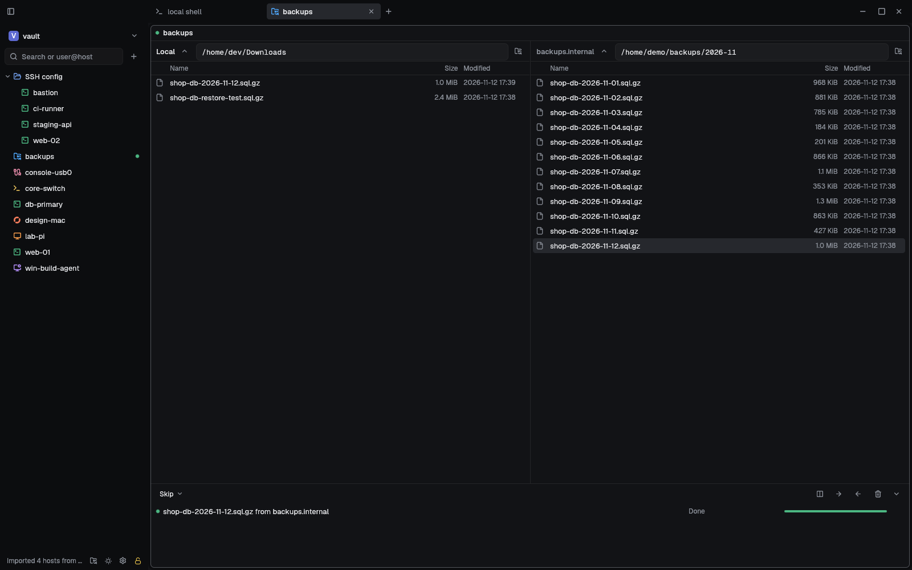
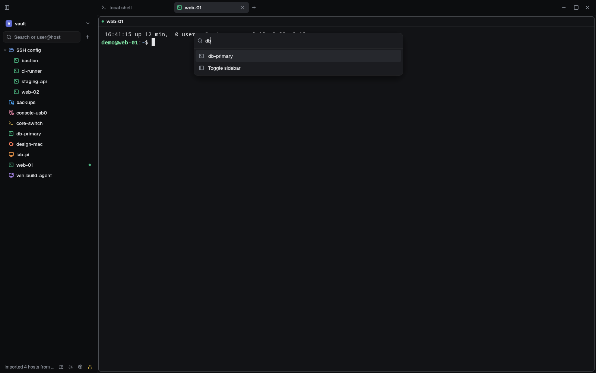
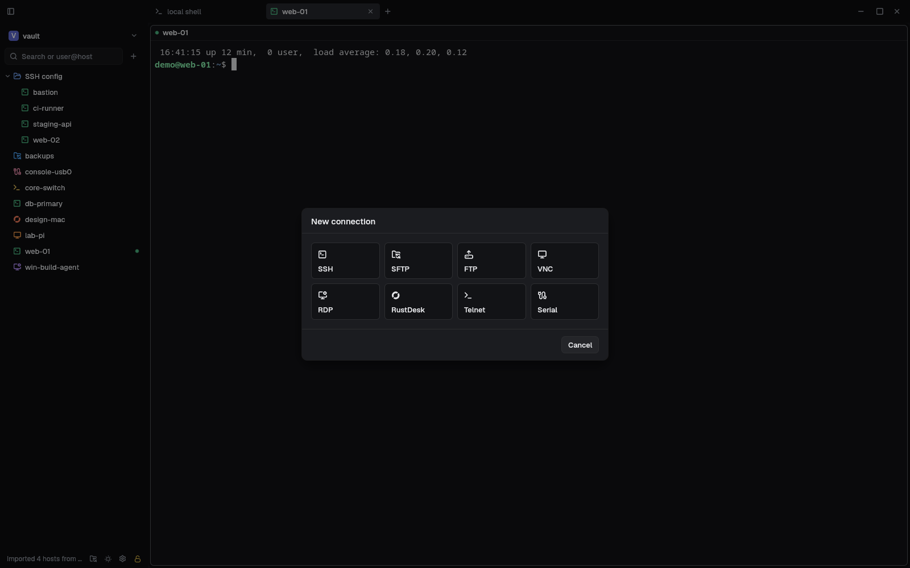
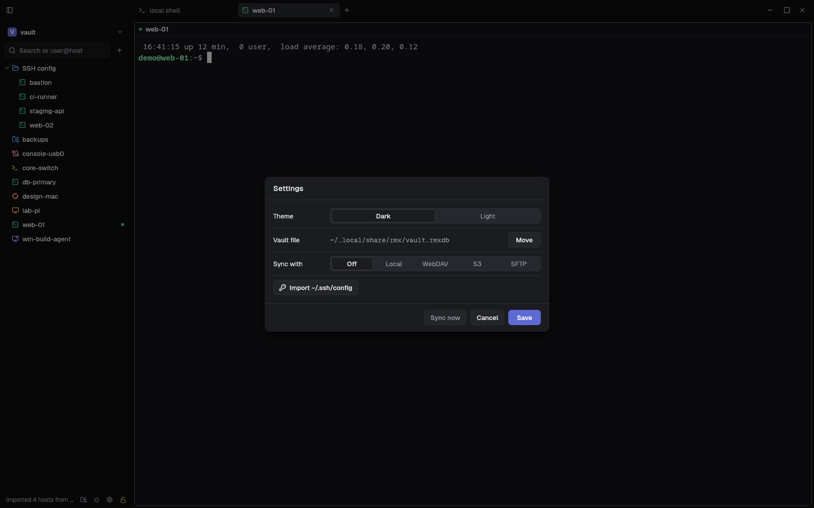

<div align="center">



# rmx

**A fast, native remote connection manager.**<br>
SSH, SFTP, FTP, RDP, VNC, RustDesk, Telnet and serial consoles in one window, with your
connections kept in an encrypted vault that syncs between your machines.

[](https://github.com/Mano-Liaoyan/rmx/actions/workflows/ci.yml)
[](https://github.com/Mano-Liaoyan/rmx/releases/latest)
[](LICENSE-APACHE)


[Install](#install) · [Features](#features) · [Build from source](#build-from-source) ·
[Testing](#testing) · [Roadmap](https://github.com/Mano-Liaoyan/rmx/issues/38)

<picture>
  <source media="(prefers-color-scheme: light)" srcset="docs/images/main-light.png">
  
</picture>

</div>

rmx is a remote connection manager written in Rust, in the tradition of MobaXterm, SecureCRT and
Remote Desktop Manager, but small, native and fast. It draws everything on the GPU, through the
same terminal core as [Alacritty](https://github.com/alacritty/alacritty), so terminal output
never waits on the interface. A single binary of under 20 MiB holds every protocol, and there
is no Electron or web view.

## See it in action

<div align="center">
  
  <br>
  <sub>Quick open, split panes, zoom, themes and an SFTP transfer, recorded from the real app. <a href="docs/images/demo.mp4">Watch the MP4</a>.</sub>
</div>

## Features

**Every protocol in one place**

| Kind | Protocols | Highlights |
|---|---|---|
| Terminals | SSH, Telnet, serial | Jump hosts (`ProxyJump`), local, remote and dynamic (SOCKS) port forwards, host key checks against `known_hosts`, key and password login, snippets |
| Files | SFTP, FTP, FTPS | Two-column browser, a transfer queue that resumes and retries, recursive copies, open and compare text files in a pane |
| Remote desktops | RDP, VNC, RustDesk | RDP with NLA and the graphics pipeline (32-bit color), shared clipboard, resize to fit, the server's own cursor; RustDesk by ID or straight at an address |

Remote desktop and file sessions can go through an SSH jump host, so an RDP or VNC machine behind
a bastion is one setting away.

**A workspace that keeps up with you**

- Tabs that split into any arrangement of panes, with animated splits and zoom. Tabs can be
  torn off into windows of their own and merged back.
- Quick open (<kbd>Ctrl</kbd>+<kbd>Shift</kbd>+<kbd>P</kbd>) finds any saved connection or
  command as you type.
- A sidebar tree of your connections, with folders and live status. Hosts from `~/.ssh/config`
  come in with one click.
- Dark and light themes, both drawn by rmx itself, so it looks the same on every platform.

**A vault you can trust**

- Connections, passwords and keys live in one [SQLCipher](https://www.zetetic.net/sqlcipher/)
  file, keyed by Argon2id over a master password and an optional key file.
- Sync the vault between machines through a local or network folder, WebDAV, S3 or SFTP. Every
  row carries a hybrid logical clock, so devices merge their changes in any order and converge.
- The vault keeps superseded versions of every row and a record of deletions.
- Rather have no master password? rmx says plainly that the file is unencrypted, and never pretends
  otherwise.

**Fast, and measured to stay fast**

Performance is a feature with a budget, checked by `cargo run -p xtask -- bench`: under 3 ms of
main-thread time for the 99th percentile frame, no heap allocations for frames that only replay
the interface, nothing drawn and no wakeups while a session is idle, and no Argon2 or network work
on the UI thread.

## Screenshots

<table>
  <tr>
    <td width="50%"><br><sub><b>SFTP and FTP browser.</b> Local and remote side by side, with a transfer queue.</sub></td>
    <td width="50%"><br><sub><b>Quick open.</b> Jump to any connection or command from the keyboard.</sub></td>
  </tr>
  <tr>
    <td width="50%"><br><sub><b>New connection.</b> Eight protocols, one dialog.</sub></td>
    <td width="50%"><br><sub><b>Settings.</b> Theme, where the vault lives, and how it syncs.</sub></td>
  </tr>
</table>

## Install

Download the package for your system from the
[latest release](https://github.com/Mano-Liaoyan/rmx/releases/latest). Each release lists the
SHA-256 of every file in `SHA256SUMS`.

| System | File | Install |
|---|---|---|
| openSUSE, Fedora, RHEL | `rmx-<version>-1.x86_64.rpm` | `sudo zypper install ./rmx-*.rpm` or `sudo dnf install ./rmx-*.rpm` |
| Debian, Ubuntu | `rmx_<version>-1_amd64.deb` | `sudo apt install ./rmx_*.deb` |
| Windows 10 and 11 (x64) | `rmx-<version>-x64.msi` | Run the installer |
| macOS (Apple silicon and Intel) | `rmx-<version>-universal.dmg` | Drag rmx to Applications |

Notes:

- **Linux packages** are built against glibc 2.36 (Debian 12), so they run on distributions from
  then on. They work under both Wayland and X11.
- **Windows:** the installer isn't signed yet, so SmartScreen may ask you to confirm with
  *More info → Run anyway*.
- **macOS:** the app is signed ad hoc and not notarized. The first time, open it with right-click
  → *Open*.

On first start, rmx asks you to create a vault, or to join one you already sync elsewhere.

## Keyboard shortcuts

Shortcuts use <kbd>Ctrl</kbd>+<kbd>Shift</kbd>, so plain <kbd>Ctrl</kbd> keys reach the remote
program untouched.

| Keys | Action |
|---|---|
| <kbd>Ctrl</kbd>+<kbd>Shift</kbd>+<kbd>P</kbd> | Quick open |
| <kbd>Ctrl</kbd>+<kbd>Shift</kbd>+<kbd>N</kbd> | New connection |
| <kbd>Ctrl</kbd>+<kbd>Shift</kbd>+<kbd>T</kbd> | New tab with a local shell |
| <kbd>Ctrl</kbd>+<kbd>Shift</kbd>+<kbd>E</kbd> / <kbd>O</kbd> | Split the pane side by side / one above the other |
| <kbd>Ctrl</kbd>+<kbd>Shift</kbd>+<kbd>Z</kbd> | Zoom the pane |
| <kbd>Ctrl</kbd>+<kbd>Shift</kbd>+<kbd>W</kbd> | Close the pane |
| <kbd>Ctrl</kbd>+<kbd>Shift</kbd>+<kbd>←</kbd> <kbd>→</kbd> <kbd>↑</kbd> <kbd>↓</kbd> | Move focus between panes |
| <kbd>Ctrl</kbd>+<kbd>Shift</kbd>+<kbd>1</kbd>…<kbd>9</kbd> | Go to tab |
| <kbd>Ctrl</kbd>+<kbd>Tab</kbd> / <kbd>Ctrl</kbd>+<kbd>Shift</kbd>+<kbd>Tab</kbd> | Next / previous tab |
| <kbd>Ctrl</kbd>+<kbd>Shift</kbd>+<kbd>C</kbd> / <kbd>V</kbd> | Copy / paste |
| <kbd>Ctrl</kbd>+<kbd>Shift</kbd>+<kbd>S</kbd> | Snippets |
| <kbd>Ctrl</kbd>+<kbd>Shift</kbd>+<kbd>B</kbd> | Show or hide the sidebar |

## Build from source

You need Rust 1.94 or newer ([rustup](https://rustup.rs)) and a C compiler. SQLCipher is compiled
in and links the system's OpenSSL `libcrypto`.

**Linux**

```sh
# openSUSE
sudo zypper install gcc-c++ pkgconf-pkg-config fontconfig-devel freetype2-devel libopenssl-devel
# Fedora
sudo dnf install gcc-c++ pkgconf-pkg-config fontconfig-devel freetype-devel openssl-devel
# Debian, Ubuntu
sudo apt install build-essential pkg-config libfontconfig1-dev libfreetype-dev libssl-dev

git clone https://github.com/Mano-Liaoyan/rmx.git
cd rmx
cargo build --release
./target/release/rmx
```

If you have no OpenSSL headers, `cargo build --release --features rmx-app/vendored-openssl`
compiles OpenSSL and links it statically.

**Windows** (PowerShell, with the Visual Studio C++ build tools)

```powershell
. ./packaging/windows/openssl.ps1   # finds or installs a prebuilt static OpenSSL
cargo build --release
```

**macOS** (with the Xcode command line tools)

```sh
cargo build --release
```

**Packages.** `cargo run -p xtask -- package` builds the `.rpm` and `.deb` inside a Debian 12
container (see [`packaging/Containerfile`](packaging/Containerfile)), so they run on older glibc.
`packaging/windows/build.ps1` and `packaging/macos/build.sh` make the `.msi` and `.dmg`; the
[release workflow](.github/workflows/release.yml) runs all three when a version tag is pushed.

## Testing

```sh
cargo fmt --all --check
cargo clippy --workspace --all-targets -- -D warnings
cargo clippy --workspace --all-targets --features rmx-app/bench -- -D warnings
cargo test --workspace
```

CI runs these on every pull request, and builds the app on Windows and macOS.

Some tests need more than `cargo test` gives them:

- **Against real servers.** The SSH, SFTP, FTP, VNC, RDP (xrdp) and vault sync tests start
  disposable servers with [podman](https://podman.io) or Docker. They're marked `#[ignore]`, so
  run them with `cargo test --workspace -- --ignored`.
- **The GUI.** `scripts/headless.sh` runs a command in a private, invisible KWin session, so
  nothing ever opens on your desktop:

  ```sh
  scripts/headless.sh target/release/rmx
  ```

- **End to end.** `cargo run -p xtask -- e2e` drives the real interface through scripted steps
  inside `scripts/headless.sh`, against podman servers, and saves a screenshot of each step.
- **Performance.** `cargo run -p xtask -- bench` measures frame times, startup, allocations and
  binary size against the budgets in [`xtask/src/main.rs`](xtask/src/main.rs).

## Project layout

| Crate | What it does |
|---|---|
| [`rmx-app`](crates/rmx-app) | The application: windows, sessions, the vault and sync, wiring everything together |
| [`rmx-ui`](crates/rmx-ui) | The interface's widgets, theme and icons, on egui |
| [`rmx-render`](crates/rmx-render) | GPU rendering of terminals, remote desktops and the interface |
| [`rmx-terminal`](crates/rmx-terminal) | Terminals built on `alacritty_terminal`, and local shells |
| [`rmx-layout`](crates/rmx-layout) | Tabs, split panes, drag and drop, and their animations |
| [`rmx-ssh`](crates/rmx-ssh) | SSH: authentication, jump hosts, tunnels and port forwarding |
| [`rmx-transfer`](crates/rmx-transfer) | Browsing and copying files over local disk, SFTP, FTP and FTPS |
| [`rmx-rdp`](crates/rmx-rdp) | RDP client, on [IronRDP](https://github.com/Devolutions/IronRDP) |
| [`rmx-vnc`](crates/rmx-vnc) | VNC client |
| [`rmx-rustdesk`](crates/rmx-rustdesk) | An independent RustDesk client |
| [`rmx-serial`](crates/rmx-serial) | Telnet and serial ports |
| [`rmx-display`](crates/rmx-display) | The interface between remote desktop clients and the renderer |
| [`rmx-vault`](crates/rmx-vault) | The encrypted connection database and its sync |
| [`xtask`](xtask) | Benchmarks, end-to-end tests and packaging |

The protocol crates have no UI or GPU code, so each can be tested alone.

## Known limitations

rmx is young (version 0.1). Things that don't work yet, each tracked in an issue:

- **RDP:** no H.264 (AVC420/AVC444) decoding ([#50](https://github.com/Mano-Liaoyan/rmx/issues/50)),
  no session audio ([#51](https://github.com/Mano-Liaoyan/rmx/issues/51)), no shared folders or
  other devices ([#56](https://github.com/Mano-Liaoyan/rmx/issues/56)), no RD Gateway
  ([#57](https://github.com/Mano-Liaoyan/rmx/issues/57)) and no UDP transport
  ([#60](https://github.com/Mano-Liaoyan/rmx/issues/60)).
- **VNC:** traffic is only encrypted when tunnelled over SSH, until VeNCrypt lands
  ([#16](https://github.com/Mano-Liaoyan/rmx/issues/16)). The clipboard is ASCII only, and very
  large desktops aren't supported yet ([#15](https://github.com/Mano-Liaoyan/rmx/issues/15)).
- **SSH:** no X11 forwarding ([#23](https://github.com/Mano-Liaoyan/rmx/issues/23)).
- **Terminal:** combining accents can render at an offset
  ([#13](https://github.com/Mano-Liaoyan/rmx/issues/13)), and typed characters don't show when a
  Telnet server refuses to echo ([#12](https://github.com/Mano-Liaoyan/rmx/issues/12)).
- **Packages:** the `.rpm`, `.deb`, `.msi` and `.dmg` aren't signed yet
  ([#21](https://github.com/Mano-Liaoyan/rmx/issues/21)).

The [roadmap](https://github.com/Mano-Liaoyan/rmx/issues/38) lists the work ahead and the order it
lands in.

## Contributing

Bug reports and pull requests are welcome. Before opening a pull request:

1. Run the checks under [Testing](#testing). CI requires `fmt`, `clippy` and the tests to pass.
2. Keep the performance rules: no I/O on the main thread, terminal output never runs the egui
   pass, and no per-frame allocations on frames that only replay the interface.
3. Keep each pull request to one issue, with a commit message that says what changed and why.

## License

rmx is licensed under the [Apache License, Version 2.0](LICENSE-APACHE).

The terminal renderer, key encoding and pane layout code derive from
[Alacritty](https://github.com/alacritty/alacritty), through the alacritty-tabbed fork. The
interface's design tokens follow [dbx](https://github.com/t8y2/dbx). Both are Apache-2.0; see
[`NOTICE`](NOTICE).
